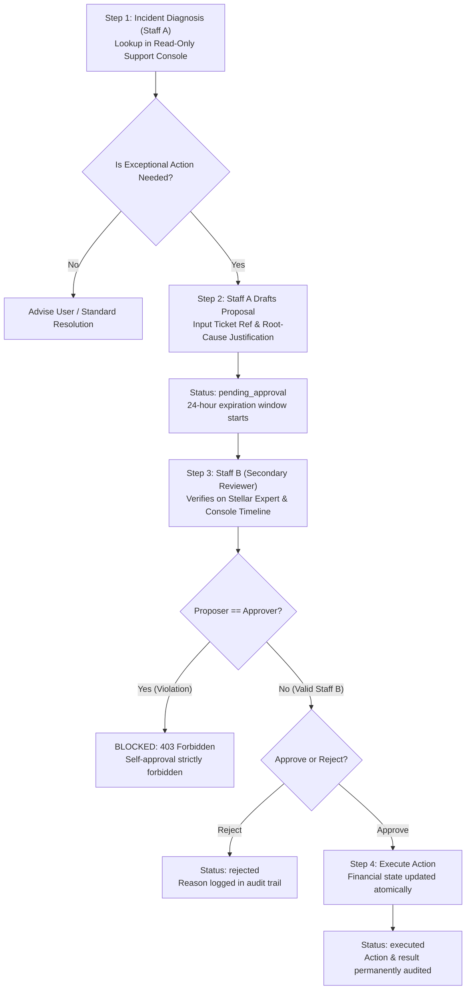

# Dual-Control Operating Procedure & Incident-Response Console

**Status:** Official Operations Procedure  
**Applies To:** Customer Support, Incident Response Team, System Operators  
**Related Issue:** #314 (Create an incident-response and support console)  
**System Invariants Enforced:** Invariant 1 (Authoritative on-chain reality), Invariant 4 (Zero secret leakage), Invariant 6 (Audit trail completeness)

---

## 1. Overview & System Invariants

When payments fail, stall in network mempools, or exhibit discrepancies between off-chain database rows and Stellar Horizon ledgers, support staff require immediate end-to-end diagnostic visibility.

The **StellarStar Support Console** (`/support` and `/api/support/lookup`) provides a unified, read-only diagnostic view that stitches together:
- Expense records and share distributions
- Durable settlement intents and idempotency keys
- Stellar Horizon ledger consensus and payment operation records
- Soroban smart contract payment proof events
- Chronological, step-by-step cryptographic timeline

### Core Security Guarantees
1. **Read-Only by Default:** The incident console is strictly non-mutating. Looking up transactions, wallets, or trips can never alter financial state, balances, or user debts.
2. **Zero Secret Leakage:** No private keys, secret seed phrases (`S...`), authorization bearer tokens, JWT secrets, or session cookies are ever visible to support staff or returned across API boundaries. All payloads undergo deep recursive redaction.
3. **Mandatory Audit Logging:** Every customer data lookup performed by support staff is logged with the staff identifier, query type, timestamp, IP address, and masked query parameters.
4. **Four-Eyes Dual-Control Enforcement:** Exceptional corrective modifications to financial state cannot be performed by any single operator. A proposal must be submitted by Staff Member A and approved by a distinct Staff Member B before execution.

---

## 2. Investigation Workflows & Query Types

Authorized staff can query the support console using five query identifiers:

| Query Type | Format / Example | Target Data | Diagnostic Use Case |
| :--- | :--- | :--- | :--- |
| **Transaction Hash** | `64 hex chars`<br>`826092e112...` | Horizon ledger & operations | Verifies whether a payment moved value on Stellar, confirmed ledger, and delivering assets. |
| **Wallet Address** | `G[A-Z0-9]{55}`<br>`GBZXN7PIRZ...` | All intents involving this account | Traces debt obligations, outbound payments, or received settlements for a member. |
| **Correlation ID** | `req-...`<br>`req-93e1a-821` | Exact transaction session | Direct linkage from client error report or alert webhook to the full payment flow. |
| **Expense ID** | UUID format | Specific expense row & shares | Checks which members have settled and which shares remain pending. |
| **Trip ID** | UUID format | Trip metadata & all expenses | Surveys an entire travel workspace's financial settlement status. |

### Accessing Network Explorers
The console automatically resolves links to the configured network explorer (`STELLAR_EXPLORER`):
- **Testnet:** `https://stellar.expert/explorer/testnet/`
- **Mainnet (Public):** `https://stellar.expert/explorer/public/`

Always cross-reference the transaction hash and closed ledger sequence directly on Stellar Expert before diagnosing customer claims.

---

## 3. The Dual-Control (Four-Eyes Principle) Procedure

Under standard operations, support agents only provide read-only assistance. However, exceptional conditions may arise:
- A user's wallet crashed after creating an intent that locked a debt lock, preventing further payments.
- Horizon confirmed a transaction, but network timeouts delayed the Supabase share recording.
- An ambiguous transaction requires escalation and freezing pending financial review.

To prevent unilateral errors or insider compromise, any corrective action requires **Dual-Control (Four-Eyes Approval)**.

### Allowed Corrective Actions

1. `FORCE_RECONCILE`: Forces the backend reconciliation engine to re-verify a submitted transaction hash against Horizon and Soroban contract state, catching up missing Supabase share records.
2. `MARK_INTENT_FAILED`: Safely terminates an expired intent that never broadcasted a transaction hash, releasing the debt lock so the member can retry payment.
3. `FLAG_AMBIGUOUS_INVESTIGATION`: Escalates an ambiguous payment (e.g. amount mismatch, wrong asset, duplicate intent) to senior financial engineering while freezing automatic resolution.

### Step-by-Step Dual-Control Workflow



#### Step 1: Verification & Ticket Requirement
- The incident must have a logged issue tracking ticket (e.g., `INC-2026-1021` or GitHub issue `#314`).
- Staff Member A must verify that no on-chain double-spend will occur by inspecting both the payer's and recipient's account history on Stellar Expert.

#### Step 2: Proposing the Action (Staff Member A)
Staff Member A calls `POST /api/support/actions/propose` or clicks **"Dual-Control Action"** in `/support`:
```json
{
  "actionType": "MARK_INTENT_FAILED",
  "targetId": "s0a80101-0000-4000-8000-000000000001",
  "targetType": "intent",
  "ticketRef": "INC-2026-1021",
  "reason": "Wallet timed out during Freighter signing. Stellar Expert confirms no transaction was broadcast within 2 hours. Cancelling expired intent to unblock user."
}
```
The proposal is assigned a unique UUID and set to `pending_approval` with a 24-hour expiration.

#### Step 3: Independent Secondary Review (Staff Member B)
- Staff Member B reviews the proposal in the support console.
- Staff Member B independently loads the target intent and verifies:
  1. The ticket reference is valid and active.
  2. The justification matches the immutable ledger reality on Stellar Expert.
  3. No competing transaction exists in Horizon.

#### Step 4: Approval & Execution (Staff Member B)
Staff Member B approves the proposal:
```http
POST /api/support/actions/approve
Content-Type: application/json
x-staff-secret: <staff-member-b-secret>

{
  "proposalId": "c0a80101-4444-4000-8000-000000000001"
}
```
**Strict Backend Enforcement:** If the approver matches the proposer, the backend throws `DUAL_CONTROL_SELF_APPROVAL_PROHIBITED` (HTTP 403) and logs a security policy violation event.

Once approved by Staff Member B:
1. The corrective action executes atomically.
2. The proposal transitions to `executed`.
3. The result is recorded with timestamp and both staff identities in `support_corrective_actions`.

---

## 4. Audit Log Specifications & Compliance

Every staff lookup is captured in `public.support_audit_logs`:

| Column | Type | Description |
| :--- | :--- | :--- |
| `id` | `UUID` | Unique audit event identifier |
| `staff_identifier` | `TEXT` | Staff member identity or key name |
| `query_type` | `TEXT` | One of `tx_hash`, `wallet`, `trip_id`, `expense_id`, `correlation_id` |
| `query_value` | `TEXT` | Masked search query (prevents storing leaked secrets) |
| `results_count` | `INT` | Number of matching incident records returned |
| `ip_address` | `TEXT` | Origin IP of the staff operator |
| `user_agent` | `TEXT` | Client user agent string |
| `created_at` | `TIMESTAMPTZ` | High-resolution timestamp of access |

Compliance officers can query the audit logs at any time via:
`GET /api/support/audit-logs?limit=100`

---

## 5. Escalation Contacts & On-Call Matrix

If an incident involves an unconfirmed on-chain transfer exceeding 500 XLM, or a suspected smart contract bug:
1. Do not use dual-control override until on-chain finality is established.
2. Escalate immediately to the **Settlement Engineering On-Call** team.
3. Provide the **Correlation ID** and **Transaction Hash**.
4. Reference the mainnet readiness runbook at [`docs/RUNBOOK.md`](RUNBOOK.md).
